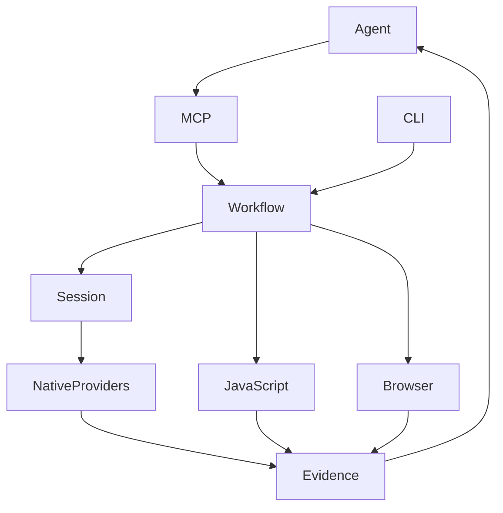

　　看到一个软件里的搜索功能，我们通常只能观察它的输入和输出。若想知道它怎样组织索引、调用哪个模块、是否访问原生库，就要进入逆向工程的世界。REA（Reverse Engineer Anything）把这些调查能力接到 AI Agent 上，让自然语言问题能够转化为工具调用，再把工具结果带回分析过程。

　　这篇文章按**直觉、原理、实践、深入**四个阶段理解 REA。资料核验日期为 2026 年 10 月 11 日；项目迭代较快，安装时应再次检查 [README](https://github.com/morluto/rea/blob/main/README.md) 和 [安装文档](https://github.com/morluto/rea/blob/main/docs/installation.md)。本文的命令是操作指南，未宣称已经对某个真实应用完成实测。

## 第一阶段：直觉理解——给 Agent 一套调查工具

　　把 REA 想成实验室里的工具接口会比较容易。Agent 负责提出假设和安排调查，REA 负责将操作送到合适的分析能力，底层工具负责读取程序、提取结构或观察行为。最终的解释仍需与证据对应。

　　例如，“这个程序的搜索是否调用本地数据库？”不能靠函数名猜出来。调查可以先定位搜索入口，再检查模块依赖和调用关系，找到数据库相关操作，最后说明哪些环节已观察到、哪些环节仍然未知。

| 角色 | 负责的事情 | 产出 |
|---|---|---|
| 用户 | 指定目标与问题 | 明确的调查范围 |
| Agent | 规划、追问、解释 | 假设和分析报告 |
| REA | 提供统一工作流和工具接口 | 结构化结果与证据 |
| 分析引擎及各类 Provider | 提取静态信息或运行时观察 | 伪代码、引用、模块、行为等 |

　　REA 的范围不只包括原生二进制，也覆盖 JavaScript/Electron、.NET 和网页等对象。不同目标需要不同能力；JavaScript 静态分析不要求先安装原生反编译器，原生分析则依赖可用引擎及主机支持。它也不承诺把任意程序完整恢复成原始源码。

## 第二阶段：原理理解——入口、工作流、Provider 与证据

　　下面是依据官方 [architecture.mermaid](https://github.com/morluto/rea/blob/main/docs/architecture.mermaid) 整理的教学简图，省略了平台适配和进程管理等分支。CLI 与 MCP 都进入共享工作流：前者适合终端操作，后者适合 Agent 交互。

<pre class="mermaid">
flowchart TD
  U[用户提出问题] --> A[AI Agent]
  A --> M[MCP 服务入口]
  C[CLI 入口] --> W[共享应用工作流]
  M --> W
  W --> S[Session 与 Provider 路由]
  S --> N[Hopper / Ghidra / IDA]
  W --> J[JavaScript / Electron 分析]
  W --> B[浏览器与运行时观察]
  W --> D[其他目标适配能力]
  N --> E[证据与未知点记录]
  J --> E
  B --> E
  D --> E
  E --> A
  A --> R[解释、实现与验证]
</pre>

### 可复制的 Mermaid 源码




<script type="module">
import mermaid from 'https://cdn.jsdelivr.net/npm/mermaid@11/dist/mermaid.esm.min.mjs';
mermaid.initialize({startOnLoad:true,securityLevel:'strict',theme:'default'});
</script>

### MCP：让模型知道能调用什么

　　MCP 服务公开工具及其输入输出约束。但“出现在工具目录中”与“当前可以调用”是两件事：当前目标、Provider、主机和客户端能力都会影响可用性。官方 [MCP 合约](https://github.com/morluto/rea/blob/main/docs/mcp-contracts.md) 要求调用方通过 `binary_session` 检查当前工具能力。

　　源码阅读可从 [src/main.ts](https://github.com/morluto/rea/blob/main/src/main.ts)、[src/server/](https://github.com/morluto/rea/tree/main/src/server) 和 [src/contracts/](https://github.com/morluto/rea/tree/main/src/contracts) 开始，分别理解启动、请求适配和调用约束。

### Provider：选择真正执行分析的能力

　　Provider 将统一操作适配到实际分析工具。原生深度分析会为目标确定一个绑定；当前合约明确说明，选中的 Provider 在运行失败后不会自动换成另一个。这样更容易解释结果来自什么引擎，也避免一次调查里无声混用不同分析语义。

　　对应源码入口为 [src/composition/](https://github.com/morluto/rea/tree/main/src/composition)、[src/application/](https://github.com/morluto/rea/tree/main/src/application)、[src/ghidra/](https://github.com/morluto/rea/tree/main/src/ghidra) 和 [bridge/ghidra/ReaGhidraBridge.java](https://github.com/morluto/rea/blob/main/bridge/ghidra/ReaGhidraBridge.java)。

### Session：保存调查上下文

　　一次调查往往包含多次查询。Session 保存当前目标、Provider 绑定和保留的证据，让后续工具能引用之前的结果。注意生命周期：关闭目标会清理保留的会话记录，需要跨会话复用时应先导出证据包。

### Evidence 与 Unknowns：把结果变成可追问的事实

　　产生证据的工具返回标准 Evidence 记录，`normalized_result` 是规范化结果，`evidence_id` 标识记录；`raw_result` 在存在时保留 Provider 原始表示。分析配置也参与证据身份。工具输出可以保留在会话中，供比较、追踪和导出继续使用。

　　Unknowns 的意义是把未解决部分显式保留下来。例如，静态结构显示某模块引用数据库接口，并不等于已经观察到每次搜索都执行数据库查询。源码里的调查记录和证据账本可从 [src/application/investigation/](https://github.com/morluto/rea/tree/main/src/application/investigation) 与 [src/domain/](https://github.com/morluto/rea/tree/main/src/domain) 继续阅读。

## REA 到底怎样实现逆向分析？——沿一次调用走进源码

　　前面的架构图回答了“有哪些模块”，但还没有回答“程序里的信息怎样被提取出来”。这一节把 REA 拆到实际操作层面。源码阅读基于提交 [`91f6840`](https://github.com/morluto/rea/tree/91f6840c35e99e5f23612920d790a30d324ac115)，下面的源码链接固定到这个版本，方便逐项对照。

### 1. 自然语言不会直接进入反编译器

　　当你问 Codex“搜索功能怎么实现”，模型先根据 REA 的工具说明选择操作，生成带参数的工具请求。REA 收到的是“对哪个路径执行哪个操作”这样的结构化输入，而不是让 Ghidra直接理解中文。

　　以 JavaScript 应用为例，下面是调用形状示意；路径要替换为实际文件位置：

```json
{
  "name": "analyze_javascript_application",
  "arguments": { "input_path": "/absolute/path/to/app" }
}
```

　　Codex 的 MCP 客户端通过 stdio 与 REA 服务进程交换协议消息。服务端注册工具名、输入约束和处理函数，校验参数后调用应用层工作流。[registerElectronTools.ts](https://github.com/morluto/rea/blob/91f6840c35e99e5f23612920d790a30d324ac115/src/server/registerElectronTools.ts) 中可以直接看到 `server.registerTool(...)`，以及处理函数如何转入 `analyzeJavaScriptApplicationValidated(...)`。

　　这意味着 REA 的一次工具调用不需要内置一个大模型来猜程序行为。即使不使用 Codex，也可以通过 CLI 执行同一类分析。**模型的推理循环在 Agent 一侧，文件解析和反编译在工具一侧。**

<pre class="mermaid">
sequenceDiagram
  participant C as Codex / 模型
  participant R as REA MCP 服务
  participant W as 应用工作流
  participant P as 解析器或 Ghidra
  C->>R: 工具名 + 路径或函数地址
  R->>R: 校验输入与可用能力
  R->>W: 调用对应工作流
  W->>P: 请求程序结构或函数分析
  P-->>W: 模块、调用关系或伪代码
  W->>W: 校验并生成 Evidence
  W-->>R: 结构化证据
  R-->>C: 工具结果
  C->>C: 解释结果、提出下一次查询
</pre>

### 2. JavaScript 路线：文本 → AST → 模块图与语义图

　　假设应用里有两个文件：

```javascript
// search.js
export function search(items, query) {
  return items.filter(item => item.includes(query));
}

// main.js
import { search } from './search.js';
export function run(items, query) {
  return search(items, query);
}
```

　　这里的信息不是靠模型逐字符阅读后凭印象拼起来的。REA 的静态分析链路可以拆成以下步骤：

1. **枚举产物。** 检查输入路径，扫描目录或读取 ASAR 容器，建立文件清单，保留文件身份与摘要。ASAR 是 Electron 常见的资源归档；读取容器并不等于执行应用。
2. **读取 JavaScript。** 找到相关资源，读取源码，并在受限制的分析工作进程中处理，避免一个很大的文件无限占用主进程资源。
3. **解析语法树。** Babel parser 将文本转换成 AST（抽象语法树）。例如 `import` 是导入节点，函数是函数节点，`search(items, query)` 是调用表达式节点。节点的类型、参数和源码位置都是可程序化读取的字段。
4. **提取结构事实。** 根据节点提取模块、导入导出、声明和可识别的调用等信息。`main.js` 对 `search.js` 的依赖可以由导入表达式及路径解析建立；函数与调用等事实进入语义结构。
5. **构建并校验图。** 应用图表达模块和跨边界关系，语义图保存更细的静态关系。系统检查图结构和跨图绑定，再将结果封装成 Evidence。

　　可以把“图”理解为带出处的关系表：哪些节点存在、它们之间有什么边、边来自哪个文件位置。上面的例子中，`main.js → search.js` 是依赖关系；具体的 `run`、调用表达式与 `search` 之间能建立哪些语义关系，要以解析器实际支持和输出为准。动态生成的模块路径、间接调用或复杂混淆都可能留下未解析部分。

　　沿源码阅读的顺序是：[JavaScriptApplicationService.ts](https://github.com/morluto/rea/blob/91f6840c35e99e5f23612920d790a30d324ac115/src/application/javascript/JavaScriptApplicationService.ts) → [JavaScriptArtifactReconstruction.ts](https://github.com/morluto/rea/blob/91f6840c35e99e5f23612920d790a30d324ac115/src/application/javascript/JavaScriptArtifactReconstruction.ts) → [JavaScriptAnalysisWorker.ts](https://github.com/morluto/rea/blob/91f6840c35e99e5f23612920d790a30d324ac115/src/javascript/analysis/JavaScriptAnalysisWorker.ts) → [javascriptSourceParser.ts](https://github.com/morluto/rea/blob/91f6840c35e99e5f23612920d790a30d324ac115/src/domain/javascript/javascriptSourceParser.ts)。最后一个文件明确引入了 `@babel/parser`。

　　因此，JavaScript 路线的核心是**从交付的代码产物恢复结构**。静态分析不运行这个 `search` 函数，所以只能说明代码结构及可识别语义，不能证明某次用户操作真的执行过它。

### 3. 原生路线：机器码 → Ghidra 分析 → 桥接结果

　　原生程序里通常没有 JavaScript 那样可以直接解析的文本。编译后主要留下机器指令、数据、导入导出以及可能存在的符号信息。这时 REA 把底层分析交给 Ghidra 等引擎。

　　以 Ghidra Provider 为例，执行链如下：

1. `open_binary` 选择目标及 Provider，保存会话绑定。选择成功本身不代表反编译已经完成。
2. 首次需要引擎的查询触发启动流程。REA 准备受管理的运行环境，导入目标到 Ghidra 项目，执行分析和桥接脚本，并等待连接就绪。
3. Ghidra 根据目标格式及处理器语言解释字节，识别指令、函数和引用，并提供反编译能力。函数边界和类型等结果也可能存在分析误差。
4. REA 的 Java 桥接脚本在 Ghidra 内部运行，接收操作请求，调用 Ghidra API，并通过本地传输把结果送回 TypeScript Provider。
5. 应用层整理函数分析结果，返回可供 Agent 阅读和后续查询使用的证据。

　　最关键的代码位于 [ReaGhidraBridge.java](https://github.com/morluto/rea/blob/91f6840c35e99e5f23612920d790a30d324ac115/bridge/ghidra/ReaGhidraBridge.java)。下面是其中调用关系的简化摘录，省略了异常处理：

```java
DecompileResults results = decompiler.decompileFunction(function, 0, monitor);
DecompiledFunction value = results.getDecompiledFunction();
return value == null ? null : value.getC();
```

　　这里的 `decompiler` 是 Ghidra 的 `DecompInterface`，`getC()` 返回反编译生成的 C 风格伪代码。**REA 没有自己从零实现反编译算法；它将成熟引擎的结果接入统一调查工作流。** 桥接脚本还读取函数、指令、引用以及 Ghidra 的 HighFunction/p-code 信息，供具体分析操作使用。

　　启动与通信可继续看 [GhidraLauncher.ts](https://github.com/morluto/rea/blob/91f6840c35e99e5f23612920d790a30d324ac115/src/ghidra/GhidraLauncher.ts)、[GhidraClient.ts](https://github.com/morluto/rea/blob/91f6840c35e99e5f23612920d790a30d324ac115/src/ghidra/GhidraClient.ts) 和 [GhidraTransport.ts](https://github.com/morluto/rea/blob/91f6840c35e99e5f23612920d790a30d324ac115/src/ghidra/GhidraTransport.ts)。函数调查如何组合这些能力，可从 [EnhancedTools.ts](https://github.com/morluto/rea/blob/91f6840c35e99e5f23612920d790a30d324ac115/src/application/EnhancedTools.ts) 进入。

　　反编译出的函数名、变量名和类型可能是推断结果，优化后的程序也可能丢失原始结构。因此“得到伪代码”不等于“找回作者原始源码”。

### 4. 功能追踪：沿图找相关代码，再由 Agent 解释

　　拿到结构图以后，REA 可以围绕一个模块种子追踪关系。例如从 `search.js` 出发，检查与它相连的应用节点，形成与搜索功能相关的局部结构。源码 [JavaScriptApplicationWorkflowService.ts](https://github.com/morluto/rea/blob/91f6840c35e99e5f23612920d790a30d324ac115/src/application/javascript/JavaScriptApplicationWorkflowService.ts) 会先验证输入 Evidence，再调用领域层的 [javascriptFeatureTrace.ts](https://github.com/morluto/rea/blob/91f6840c35e99e5f23612920d790a30d324ac115/src/domain/javascript/javascriptFeatureTrace.ts) 派生追踪结果。

　　图遍历负责缩小调查范围，模型负责把代码与用户的问题联系起来。例如模型可能发现搜索入口调用一个 native addon，于是继续调查对应动态库；若静态证据不足，再请求运行时观察。**“理解功能”来自多轮工具查询与解释，不是一次图遍历就自动得到完整答案。**

### 5. 证据账本：保存工具观察，不自动证明模型结论

　　结果返回前，REA 对输出做结构校验，并建立包含目标、Provider、操作、参数、分析配置及结果等信息的 Evidence。保留记录可通过 `evidence_id` 继续引用，避免后续工具凭空接收模型重新编写的“分析事实”。

　　[EvidenceLedger.ts](https://github.com/morluto/rea/blob/91f6840c35e99e5f23612920d790a30d324ac115/src/application/investigation/EvidenceLedger.ts) 以 Evidence ID 保存记录，校验记录并处理重复或冲突，同时管理未解决问题。这些机制帮助确认“后续引用的是哪一次工具结果”。它们不保证反编译器从未出错，也不保证模型对结果的解释正确。

| 层次 | 示例 | 怎样验证 |
|---|---|---|
| 工具观察 | 某函数存在数据库相关引用 | 查看引用、地址和对应 Evidence |
| 模型推断 | 搜索可能通过数据库执行 | 检查完整调用路径及替代解释 |
| 运行时观察 | 某次搜索交互触发了相关操作 | 捕获行为并关联具体场景 |

　　至此，REA 的实现可以归纳成一条具体链路：**接收结构化请求 → 用解析器或专业引擎提取事实 → 构建和查询关系 → 校验并保存证据 → 交给 Agent 解释和继续调查。** 每个环节都有清楚的责任边界，才能判断哪里是真实观察，哪里仍需验证。

## 第三阶段：实践理解——从 JavaScript 静态分析开始

### 1. 检查环境并安装

　　当前 README 要求 Node.js 22.x（至少 22.19）、24.x（至少 24.11）或 26 及以上，并安装 npm。先检查版本：

```bash
node --version
npm --version
```

　　若希望经常从终端使用，可以安装 CLI：

```bash
npm install --global rea-agents
rea --help
```

　　若希望 Agent 调用 REA，运行官方设置入口，审阅配置变更并按提示选择客户端，完成后重启 Agent：

```bash
npx rea-agents setup
```

　　这两个入口目的不同：全局安装提供常用终端命令，setup 配置 Agent 的 MCP 接入和配套调查指引。原生 Provider 的安装与配置请按 [installation.md](https://github.com/morluto/rea/blob/main/docs/installation.md) 中对应平台的说明执行。

### 2. 对自己的 JavaScript 项目做静态分析

　　从自己拥有或获授权分析的项目开始，先准备一个包含入口文件和模块的目录。用真实绝对路径替换下面的示例路径：

```bash
npx -y rea-agents@latest analyze-javascript-application /absolute/path/to/app --json > rea-analysis.json
```

　　Mac 可使用 `/Users/你的用户名/Code/example`，Windows 可使用带引号的 `"D:/apps/example"`。官方也支持分析提取后的应用目录或 ASAR；输出包含模块、导入关系及 Electron 边界等证据。不要预设所有打包器、动态加载和混淆方式都能被完整还原。

　　第一次看结果，先回答三个小问题：入口在哪里？模块怎样连接？哪些关系未被解析？能回答这三个问题，再调查某个具体功能，通常比直接要求“还原整个应用”更有效。

### 3. 让 Agent 围绕一个问题调查

```text
请分析我指定目录中的搜索功能。
先检查当前会话和工具可用性，再定位入口、模块依赖及关键调用。
每个结论请给出对应的文件、函数、位置或 evidence_id。
分别列出已观察到的事实、推断和未知点，并建议下一步验证方法。
```

　　在 MCP 层，可以先调用 `binary_session`，参数为 `{}`。后续工具及参数应以运行服务器的工具目录为准。原生目标使用 `open_binary` 选择目标及 Provider；JavaScript 应用调查则从对应的应用分析工具开始，不必把所有目标都当作原生二进制处理。

　　当前合约允许追踪工具引用同一会话里保留的 Evidence。下面是 `trace_application_feature` 的参数形状示意，证据 ID 必须替换为分析工具真正返回的 ID，种子模块也必须存在：

```json
{
  "application": {
    "kind": "retained-evidence",
    "evidence_id": "ev_<64 lowercase hex characters>"
  },
  "seed": { "kind": "module", "value": "search.js", "match": "exact" }
}
```

### 4. 保存证据，再验证结论

　　交互式调查完成后，可按当前工具约束使用 `get_evidence_bundle` 查看保留记录，或使用 `export_evidence_bundle` 导出。对已经导出的本地包，官方提供 CLI 摘要读取示例：

```bash
rea inspect-evidence-bundle '{"path":"/tmp/evidence.json","detail":"summary","filters":{"operation":"analyze_function"}}' --format json
```

　　这里的 `evidence.json` 是已导出的证据包，不能直接拿前面重定向得到的应用分析输出替代。过滤条件也要与实际操作一致。更多终端用法参见 [docs/cli.md](https://github.com/morluto/rea/blob/main/docs/cli.md)，实现入口是 [src/cli.ts](https://github.com/morluto/rea/blob/main/src/cli.ts) 与 [src/cli/](https://github.com/morluto/rea/tree/main/src/cli)。

## 第四阶段：深入理解——工具结果怎样成为可信结论

　　REA 的工程价值在于把一次逆向调查组织为可以继续追问的工作流。对使用者而言，最值得借鉴的是以下三个习惯。

### 让每个结论有明确的证据范围

　　“存在数据库调用”“这个分支会调用数据库”“当前交互确实触发数据库查询”是三个不同层次的结论。静态分析擅长结构和可能路径，运行时观察擅长已经发生的行为。证据记录并不会自动把前者升级为后者。

　　评审一份 Agent 报告时，可以要求每条结论附上来源、范围和待验证条件。若无法对应到文件位置、函数、观察记录或证据 ID，就先把它当成假设。

### 将失败和缺失信息视为调查状态

　　Provider 不可用、目标格式不支持、查询超时，都应保留真实诊断。比如 MCP 连接成功不意味着 Ghidra 已经完成导入；首次查询可能承担引擎启动和自动分析工作。客户端等待期限与 Provider 启动期限也各自独立。应根据错误恢复，而不是让 Agent 用猜测填补空白。

　　此外，分析在本地执行不代表所有数据一定只留在本地：接入远端模型的 Agent 时，工具输出可能进入模型上下文。分析敏感样本前，应了解客户端和模型的实际数据路径。

### 在游戏安全研究中借鉴证据账本

　　以下是工作流设计建议，不是 REA 已经具备的 Replay 审核产品功能。研究一个获授权的样本时，可以把问题拆成“模块做了什么”“相关逻辑位于哪里”“哪种输入触发路径”。再把样本摘要、工具版本、静态结构、运行时观察和未解决问题关联到报告中的判断。

　　对于 Replay 审核，同样可以要求判断关联具体时间段和事件，并保留替代解释。AI 可以帮助缩小人工阅读范围；最终判断要经过业务规则、对照样本和人工复核。REA 的证据组织思路可迁移，具体领域检测器仍需另行设计。

## 四阶段自检

| 阶段 | 学完后应能回答 |
|---|---|
| 直觉 | Agent、REA 和底层分析工具各自负责什么？ |
| 原理 | MCP、Provider、Session 与 Evidence 怎样协作？ |
| 实践 | 能否对自己的小项目执行分析，并追踪一个具体功能？ |
| 深入 | 能否区分事实、推断和未知点，设计下一步验证？ |

　　当我们能沿着一个问题找到证据、说清证据边界，再提出可以验证的下一步，才算真正理解了 REA 的使用方式。

## 官方资料与源码入口

- [REA 仓库与 README](https://github.com/morluto/rea)
- [完整架构图](https://github.com/morluto/rea/blob/main/docs/architecture.mermaid)
- [MCP 运行合约](https://github.com/morluto/rea/blob/main/docs/mcp-contracts.md)
- [安装与配置](https://github.com/morluto/rea/blob/main/docs/installation.md)
- [CLI 与证据指南](https://github.com/morluto/rea/blob/main/docs/cli.md)
- [JavaScript 重建实现](https://github.com/morluto/rea/tree/main/src/application/javascript)
